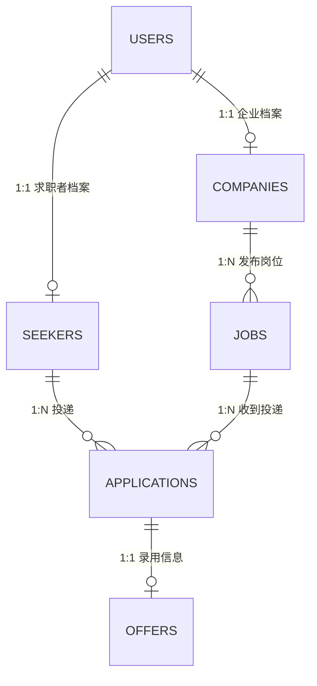

# 数据库设计说明

> 对应课程设计编号 020「网上招聘系统的设计与实现」。
> 本文档是课程设计报告「数据库设计」章节的底稿，代码见 `backend/app/models/`。

## 1. 设计原则

| 原则 | 落地方式 |
|---|---|
| 认证与身份分离 | `users` 只存登录凭证与角色；业务字段全部落在档案表 |
| 业务以主体为轴 | 岗位挂 `companies` 而非账号，避免换运营账号丢岗位 |
| 关系实体化 | 投递是「求职者 × 岗位」的多对多带属性关系，独立成 `applications` |
| 不物理删除 | 一律用 `status` 状态机（active/disabled、draft/published/closed、投递状态） |
| 约束兜底 | 唯一索引拦截并发重复投递，外键保证引用完整性 |
| 枚举字符串化 | 角色、状态以 VARCHAR 存储，日志和接口里可直接读懂 |

## 2. ER 关系



```
users 1 ── 1 seekers  1 ── N applications N ── 1 jobs 1 ── N companies 1 ── 1 users
                                   └── 0..1 offers
```

## 3. 表结构

### 3.1 `users` 账号表

| 字段 | 类型 | 约束 | 说明 |
|---|---|---|---|
| id | INTEGER | PK | 主键 |
| username | VARCHAR(32) | UNIQUE, INDEX | 登录名 |
| password_hash | VARCHAR(128) | NOT NULL | bcrypt 哈希，禁止明文 |
| role | VARCHAR(20) | INDEX | seeker / employer / admin |
| status | VARCHAR(20) | NOT NULL | active / disabled |
| last_login_at | DATETIME | NULL | 最近登录时间 |
| created_at / updated_at | DATETIME | NOT NULL | 数据库侧生成 |

### 3.2 `companies` 企业档案

| 字段 | 类型 | 约束 | 说明 |
|---|---|---|---|
| id | INTEGER | PK | 企业编号 |
| user_id | INTEGER | FK→users.id, UNIQUE | 1:1 绑定账号 |
| name | VARCHAR(100) | INDEX | 企业名称 |
| phone | VARCHAR(20) | NOT NULL | 企业电话 |
| address | VARCHAR(200) | NOT NULL | 企业地址 |
| intro | TEXT | | 企业简介 |
| industry | VARCHAR(50) | INDEX | 经营行业 |
| verified | BOOLEAN | NOT NULL | 是否已认证 |

### 3.3 `seekers` 求职者档案

| 字段 | 类型 | 说明 |
|---|---|---|
| id | INTEGER PK | 求职者编号 |
| user_id | INTEGER FK UNIQUE | 1:1 绑定账号 |
| name | VARCHAR(50) INDEX | 姓名 |
| gender | VARCHAR(10) | 性别 |
| birth_date | DATE NULL | 出生日期（**年龄不落库**，接口层按当前日期计算） |
| phone | VARCHAR(20) | 联系方式 |
| email | VARCHAR(120) NULL | 邮箱 |
| household | VARCHAR(100) | 户籍所在地 |
| education | VARCHAR(20) | 最后学历 |
| major | VARCHAR(50) | 专业 |
| degree | VARCHAR(20) | 学位 |
| school | VARCHAR(100) | 毕业学校 |
| skills | TEXT | 业务技能 |

### 3.4 `jobs` 招聘岗位

| 字段 | 类型 | 说明 |
|---|---|---|
| id | INTEGER PK | 岗位 ID |
| company_id | INTEGER FK→companies.id | 所属企业 |
| title | VARCHAR(100) INDEX | 岗位名称 |
| requirement | TEXT | 岗位要求 |
| other_requirement | TEXT | 其他要求 |
| salary_min / salary_max | INTEGER | 岗位工资区间（元/月） |
| headcount | INTEGER | 招聘人数 |
| status | VARCHAR(20) | draft / published / closed |
| published_at | DATETIME NULL | 发布时间 |

> 任务书原文把企业名称、电话、地址写进招聘信息表单。这里用 `company_id` 外键 + 联表查询实现，
> 避免「企业改电话，历史岗位全是旧号码」的数据不一致问题。

### 3.5 `applications` 投递记录

| 字段 | 类型 | 说明 |
|---|---|---|
| id | INTEGER PK | 投递 ID |
| job_id | INTEGER FK UNIQUE(job_id, seeker_id) | 投递岗位 |
| seeker_id | INTEGER FK | 投递人 |
| status | VARCHAR(20) | submitted / viewed / interview / offered / rejected |
| note | TEXT | 企业备注 |

### 3.6 `offers` 录用信息

| 字段 | 类型 | 说明 |
|---|---|---|
| id | INTEGER PK | 录用 ID |
| application_id | INTEGER FK UNIQUE | 对应投递，1:1 |
| salary | INTEGER | 录用薪资 |
| start_date | DATE NULL | 入职日期 |
| message | TEXT | 录用说明 |

## 4. 索引与约束清单

| 名称 | 类型 | 作用 |
|---|---|---|
| `ix_users_username` (unique) | 唯一索引 | 防并发注册重名 |
| `ix_companies_user_id` (unique) | 唯一索引 | 保证账号↔企业 1:1 |
| `ix_seekers_user_id` (unique) | 唯一索引 | 保证账号↔求职者 1:1 |
| `uq_applications_job_seeker` | 唯一约束 | 防并发重复投递 |
| `ix_offers_application_id` (unique) | 唯一索引 | 保证投递↔录用 1:1 |
| `ix_jobs_company_status` | 复合索引 | 企业侧按状态筛岗位 |
| `ix_applications_seeker_created` | 复合索引 | 求职者「我的投递」分页 |
| `ix_applications_job_status` | 复合索引 | 企业侧按状态筛简历 |

外键均声明 `ON DELETE CASCADE`，SQLite 连接建立时执行 `PRAGMA foreign_keys=ON` 才会真正生效
（见 `app/db/session.py`）。正式演示切换到 MySQL（`mysql+pymysql://…?charset=utf8mb4`）后，
外键由 InnoDB 直接保证，同一套模型无需改动；连接池与回收策略同样在 `session.py` 中按方言分流。

## 5. 任务书字段映射

| 任务书表单 | 任务书字段 | 落库位置 |
|---|---|---|
| 企业基本信息 | 企业编号 / 名称 / 电话 / 地址 / 简介 / 经营行业 | `companies` 全部字段 |
| 求职者信息 | 求职者编号 / 姓名 / 性别 / 出生日期 / 联系方式 / 户籍 / 学历 / 专业 / 学位 / 学校 / 技能 | `seekers` |
| 求职者信息 | 年龄 | 不入库，由 `birth_date` 推算 |
| 招聘信息 | 岗位名称 / 要求 / 工资 / 人数 / 发布时间 / 其他要求 | `jobs` |
| 招聘信息 | 企业编号 / 名称 / 电话 / 地址 | `jobs.company_id` 关联 `companies` |

## 6. 预留扩展（P1 智能模块，纯增量）

| 表 | 用途 | 与现有表关系 |
|---|---|---|
| `resumes` | 简历文件与解析结果，按版本保存 | `seeker_id` → `seekers` |
| `matches` | 匹配打分与命中理由，`UNIQUE(job_id, seeker_id)` 保证重算幂等 | 关联 `jobs` / `seekers` |

这两张表不修改任何现有字段，符合「先做任务书功能，再叠加智能能力」的分期计划。

## 7. 初始化数据

启动时由 `app/db/seed.py` 幂等写入（已存在则跳过）：

| 账号 | 密码 | 角色 |
|---|---|---|
| `yawu1122345` | `dev123123` | admin（管理员固定账号） |
| `hr_xinghe` / `hr_lanwan` | `demo123` | employer |
| `seeker_liming` / `seeker_wangfang` | `demo123` | seeker |

演示数据包含 2 家企业、3 个岗位（2 发布 / 1 草稿）、2 名求职者、3 条投递。
生产环境将 `SEED_DEMO` 设为 `false` 即可只保留管理员账号。
